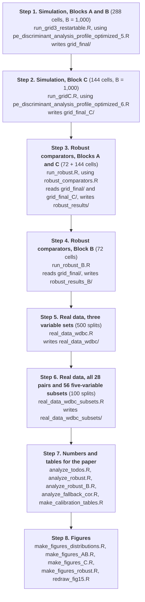

# Robustness of power exponential discriminant analysis: R code

R code for the paper

> Azuh, I. E. and Dormann, C. F. *Robustness of Power Exponential Discriminant Analysis: The Effects of Shape-Parameter Estimation and Distributional Misspecification.*

The paper compares power exponential (PE) discriminant analysis, with an estimated shape parameter, against linear and quadratic discriminant analysis (LDA, QDA) in a Monte Carlo study of 432 scenarios (Blocks A, B and C, 1,000 replicates each), adds minimum covariance determinant (MCD) and multivariate-*t* rules as comparators, and uses the Wisconsin diagnostic breast cancer data as a real-data illustration.

This repository contains all scripts that produced the results, tables and figures of the paper. The simulation output (one file per scenario cell) is large and is not stored here; it is regenerated by the scripts, and every cell has a recorded seed (`design_with_seeds.csv`).

## How everything was run



Run all scripts from the repository root, in this order. All scripts use relative paths, so the scripts and the output folders must sit in the same working directory.

| Step | Command | Reads | Writes |
|---|---|---|---|
| 1 | `source("run_grid3_restartable.R")` | `pe_discriminant_analysis_profile_optimized_5.R` | `grid_final/` (cells, `calibration.csv`, `design_with_seeds.csv`, `cell_summary.csv`, `run_log.csv`) |
| 2 | `source("run_gridC.R")` | `pe_discriminant_analysis_profile_optimized_6.R` | `grid_final_C/` (same structure) |
| 3 | `source("run_robust.R")` | `grid_final/`, `grid_final_C/`, `robust_comparators.R` | `robust_results/` |
| 4 | `source("run_robust_B.R")` | `grid_final/`, `robust_comparators.R` | `robust_results_B/` |
| 5 | `source("real_data_wdbc.R")` | `dslabs::brca` | `real_data_wdbc/` |
| 6 | `source("real_data_wdbc_subsets.R")` | `dslabs::brca` | `real_data_wdbc_subsets/` |
| 7 | `source("analyze_todos.R")`, `source("analyze_robust.R")`, `source("analyze_robust_B.R")`, `source("analyze_fallback_cor.R")`, `source("make_calibration_tables.R")` | the folders above | numbers printed to the console, `calibration_tables.tex` |
| 8 | `source("make_figures_distributions.R")`, `source("make_figures_AB.R")`, `source("make_figures_C.R")`, `source("make_figures_robust.R")`, `source("redraw_fig14.R")`, `source("redraw_fig15.R")` | the folders above | `figures/` (PDF and PNG) |

Steps 1 to 4 are restartable: a finished cell is skipped when a script is run again, and an incomplete file is rerun. Steps 1 and 2 are the long runs (Blocks A and B: 342 minutes on 15 workers; Block C: about 2.5 hours on 15 workers). Step 4 took 16 minutes and the variable-subset analysis in step 6 about 17.5 minutes.

Each script that has a quick check offers a dry run with a few replicates, for example

```r
options(pe.dry_run = TRUE); source("run_gridC.R"); options(pe.dry_run = NULL)
```

## Files

| File | Purpose |
|---|---|
| `pe_discriminant_analysis_profile_optimized_5.R` | PE density, maximum-likelihood fitting with profile likelihood for the shape, fallback policy, data generators for Blocks A and B, calibration of the class separation to a target Bayes error, one replicate of the simulation |
| `pe_discriminant_analysis_profile_optimized_6.R` | Version 5 plus the Block C generators (Student *t*, contaminated normal, skew-normal, skew-*t*); the PE fitting code is identical to version 5 |
| `run_grid3_restartable.R` | Calibration and simulation of the 288 cells of Blocks A and B, in parallel |
| `run_gridC.R` | Calibration and simulation of the 144 cells of Block C |
| `robust_comparators.R` | MCD-based Gaussian rules and multivariate-*t* rules (pooled and class-specific) |
| `run_robust.R` | Robust comparators on Block A (n in {50, 250}, p in {2, 5}) and Block C; regenerates the same training and test data from the stored seeds |
| `run_robust_B.R` | Robust comparators on the 72 cells of Block B |
| `real_data_wdbc.R` | Wisconsin breast cancer data: three nested variable sets, 25, 50 and 100 patients per class, 500 stratified splits |
| `real_data_wdbc_subsets.R` | Sensitivity analysis over all 28 pairs and 56 five-variable subsets of the eight measurements |
| `analyze_todos.R` | Sensitivity analyses (boundary estimates accepted, failed replicates removed), shape-estimation accuracy, largest Monte Carlo standard errors |
| `analyze_robust.R`, `analyze_robust_B.R` | Tables of the robust-comparator study |
| `analyze_fallback_cor.R` | Within-cell and cell-level correlations between shape-estimation error and the paired difference, with and without fallback replicates |
| `make_calibration_tables.R` | Appendix tables of the calibrated location differences and realised Bayes errors |
| `make_figures_*.R`, `redraw_fig14.R`, `redraw_fig15.R` | Figures of the paper |

## Checks built into the scripts

* Each stored cell records the MD5 checksum of the simulation script that produced it (`config$script_md5`), so a cell produced by another version of the code is rejected and rerun.
* `run_robust.R` and `run_robust_B.R` regenerate the training and test data of every replicate and stop unless the regenerated Bayes error and LDA error equal the stored ones exactly (maximum difference 0).

## Requirements

* R 4.5.3
* Packages: `MASS`, `parallel` (both ship with R), `robustbase` (MCD), `dslabs` (breast cancer data), `ggplot2` (>= 3.4, for the figures).

To record the session used for a run:

```r
writeLines(capture.output(sessionInfo()), "sessionInfo.txt")
```

## Data

The Wisconsin diagnostic breast cancer data are public: Wolberg, W., Mangasarian, O., Street, N. and Street, W. (1993), *Breast Cancer Wisconsin (Diagnostic)*, UCI Machine Learning Repository, <https://doi.org/10.24432/C5DW2B>. The scripts take them from the `brca` data set of the R package `dslabs`. All other data are simulated.

## Citation

Please cite the paper (reference to be added when published).
